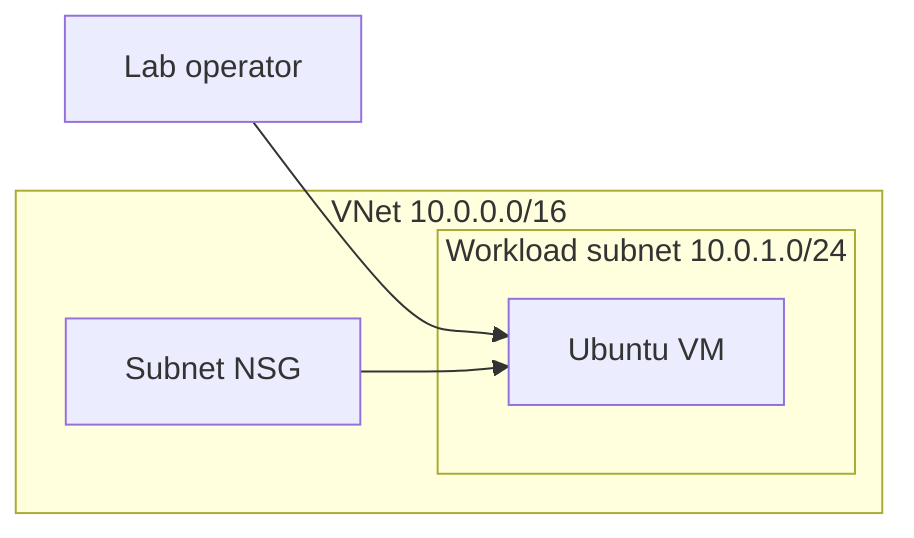

# Cloud Labs

Hands-on Microsoft Azure, Cisco Packet Tracer and Terraform labs, with two Flask prototypes. The labs cover how to build, verify and troubleshoot small infrastructure environments.

## Azure CLI labs

Start with the [Azure lab notes](Azure/). Labs 01–07 cover CLI sign-in and subscription inspection, a resource group in East US, a virtual network (10.0.0.0/16), a workload subnet (10.0.1.0/24), an NSG attached to that subnet, and an Ubuntu ARM64 virtual machine. The notes use Azure CLI commands including `az group create`, `az network vnet create`, `az network vnet subnet update` and `az vm create`.



The later notes cover VM lifecycle, SSH, HTTP access, blob storage, Azure Monitor metrics and CPU alerts, Key Vault, Bastion in a dedicated subnet, a Standard Load Balancer with an HTTP health probe, and VM backup. Each note has its own scope and prerequisites. Use your own lab resource names, subscription and VM endpoint. Use a disposable secret for the Key Vault exercise and keep its value out of committed commands and output.

To troubleshoot, confirm the subscription and region, verify the subnet and NSG attachment, and check effective rules at both subnet and NIC. For the load balancer, check backend membership, whether the service answers on port 80 and the health probe path. Check VM power state with `az vm get-instance-view` before investigating SSH connectivity. Track billable resources and remove the lab resources when finished.

## Terraform

[Lab 17](Terraform/azure-lab-17/) declares an East US resource group and a Standard locally redundant storage account using the HashiCorp AzureRM provider (3.x constraint). The tracked lockfile records the resolved provider. The storage account name must be globally unique. Authenticate to a lab subscription, adjust the name if needed and run:

```bash
cd Terraform/azure-lab-17
terraform init
terraform validate
terraform plan
```

Review the plan before applying it. Keep state and local variable files private. No new cloud resources were provisioned during the portfolio review.

## Cisco Packet Tracer

| Lab | What the lab documentation shows |
| --- | --- |
| [01 · VLANs and inter-VLAN routing](Networking/Packet-Tracer-Labs/Lab-01-VLAN-InterVLAN/) | VLANs 10, 20 and 30, an 802.1Q trunk and router subinterfaces for inter-VLAN forwarding. |
| [02 · DHCP](Networking/Packet-Tracer-Labs/Lab-02-VLAN-DHCP/) | Per-VLAN DHCP pools and default gateways. Verify leases with `show ip dhcp binding` and check client addressing before testing connectivity. |
| [03 · ACLs](Networking/Packet-Tracer-Labs/Lab-03-ACLs/) | Inbound extended ACLs on the Sales and IT router subinterfaces restrict cross-VLAN access. HTTP and ICMP to the designated server require matching return rules because the ACLs are stateless. |
| [04 · OSPF](Networking/Packet-Tracer-Labs/Lab-04-OSPF/) | Three routers in a triangle use OSPF process 1, area 0, to advertise site LANs and /30 WAN links. The lab records adjacency, learned routes and end-to-end pings. |

Open each lab's `.pkt` in Cisco Packet Tracer and use the corresponding README and topology image. Verify trunks and subinterfaces before troubleshooting DHCP or ACLs, then compare the routing table and neighbor state for OSPF.

## Python prototypes

- [Billing System](Python/BillingSystem/) supports a customer and invoice workflow using Flask and in-memory data.
- [Drink Credit System](Python/DrinkSystem/) covers guest credits, QR codes and a redemption log, with data in memory.

## Lessons and next steps

The ACL lab demonstrates why request and return traffic both need verification. The OSPF lab demonstrates checking adjacencies and route installation before relying on an application-level test. Next steps include saving sanitized verification output, parameterizing the Terraform storage account name and rerunning the labs in isolated environments.
